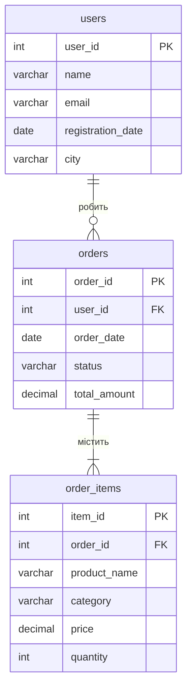

## Схема бази даних

-- Електроніка лідирує і за доходом (17 950 грн, ≈43% від загального), і за кількістю проданих одиниць (11). Меблі продали лише 4 одиниці, але дохід майже такий же (15 401 грн), бо середній чек за одиницю значно вищий.
