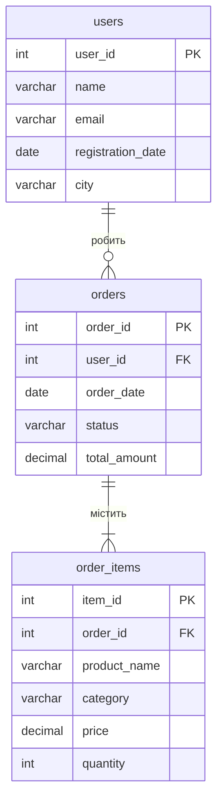

## Схема бази даних

-- Електроніка лідирує і за доходом (17 950 грн, ≈43% від загального), і за кількістю проданих одиниць (11). Меблі продали лише 4 одиниці, але дохід майже такий же (15 401 грн), бо середній чек за одиницю значно вищий.

-- У квітні дохід зріс на 36,3% відносно березня, у травні впав на 24,4%. Дані за червень охоплюють лише 1 день (одне замовлення), тому падіння на 83% не можна вважати реальною тенденцією.

-- Чотири найбільші клієнти принесли ≈90% доходу (37 701 з 41 751 грн), тож бізнес залежить від невеликої групи покупців. Лідер: Олександр Петренко (10 050 грн).

-- 4 з 6 клієнтів потрапили в сегмент VIP (витрати від 8 000 грн), решта 2 в сегмент New. Сегмента Regular немає, тому пороги можна переглянути, якщо дані зміняться.

